# 配图参考索引

这些样例提供视觉和组合参考。根据内容选择与重组元素，使用边界见 [配图积木指南](README.md)。图片均为当前收录的浅色版；精确尺寸、哈希与可编辑来源状态见 `catalog.json`。

| 名称 | 关系参考 | 原图 |
| --- | --- | --- |
| 框内增长 (`production`) | `frame-and-content` | [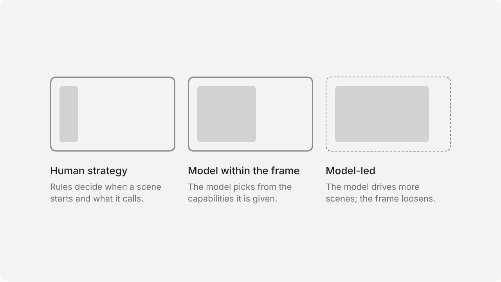](references/ai-production-light.png) |
| 热力格 (`heat`) | `matrix` | [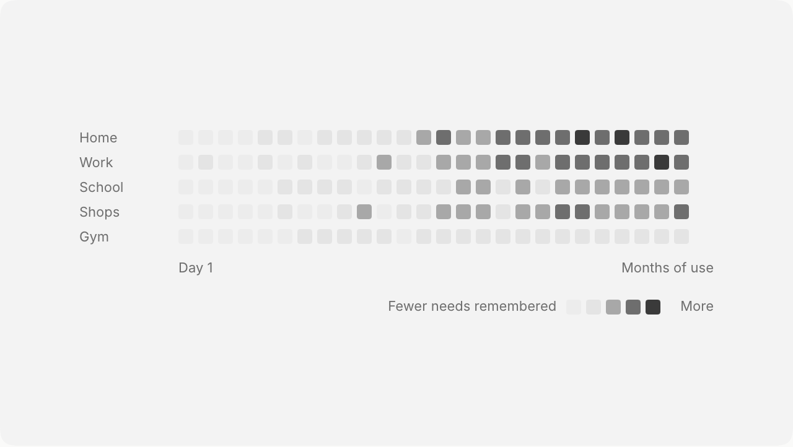](references/ai-heat-light.png) |
| 场景验证 (`poc`) | `hero-steps-capabilities` | [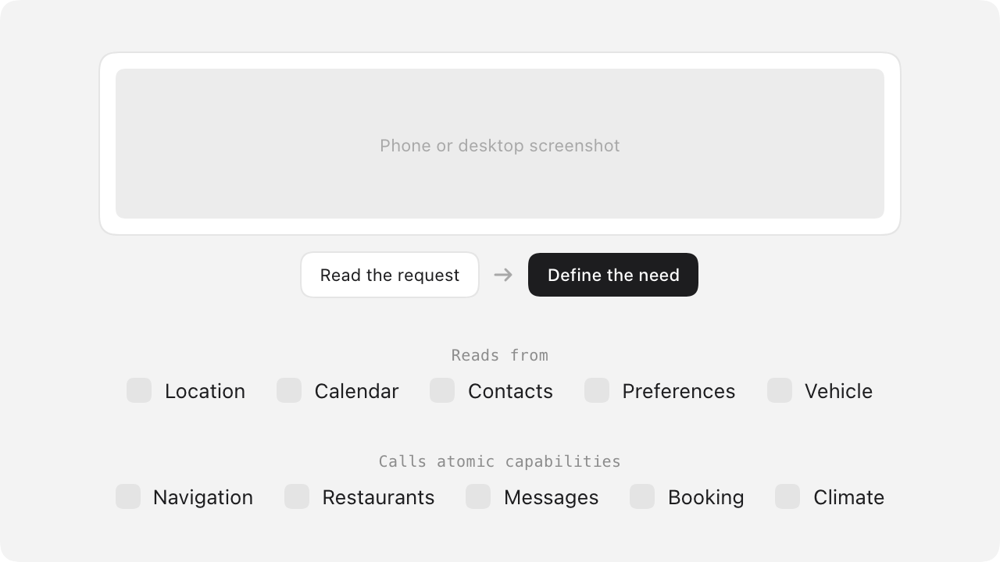](references/ai-poc-light.png) |
| 飞轮 (`flywheel`) | `feedback-loop` | [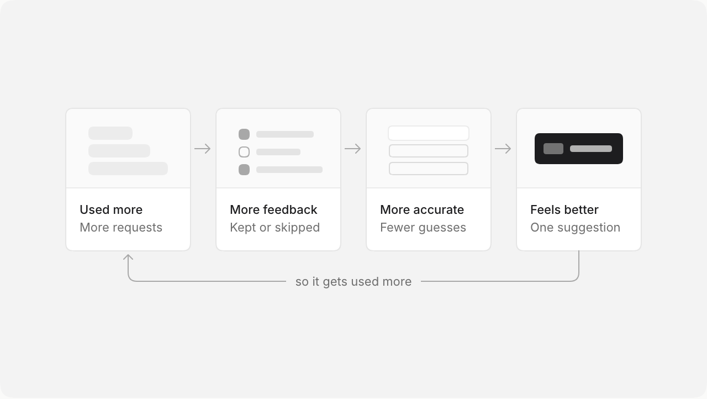](references/ai-flywheel-light.png) |
| 线索汇聚 (`signals`) | `signal-convergence` | [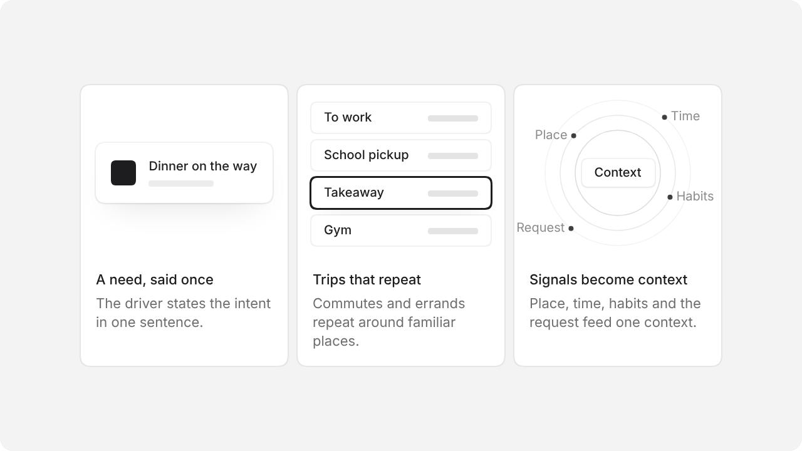](references/ai-signals-light.png) |
| 需求决定框架 (`need`) | `conditional-branch` | [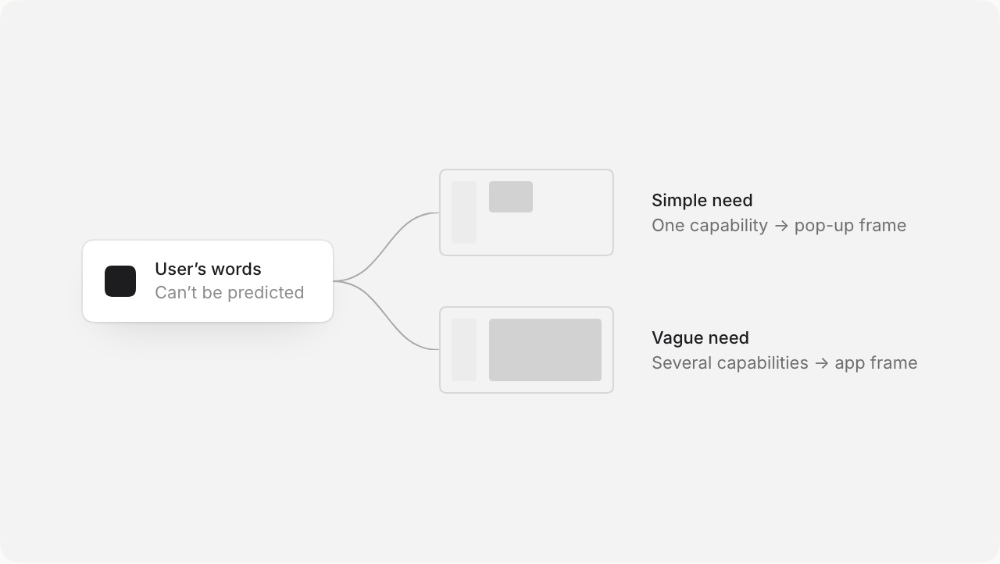](references/ai-need-light.png) |
| 可达范围 (`reach`) | `matrix` | [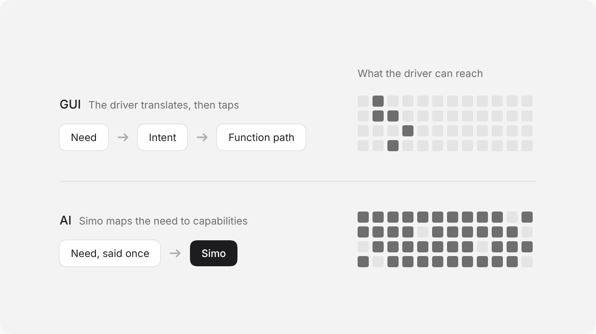](references/ai-reach-light.png) |
| 级别卡 (`voice`) | `levels` | [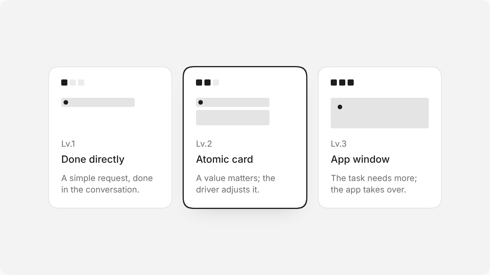](references/ai-voice-light.png) |
| 反问 (`precision`) | `clarification` | [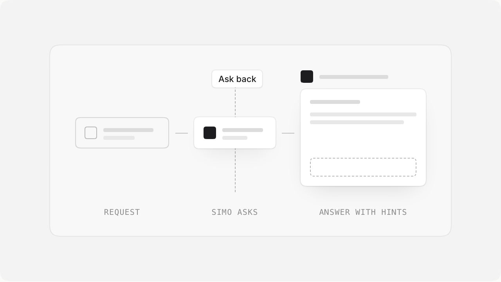](references/ai-precision-light.png) |
| 生命周期 (`life`) | `timeline` | [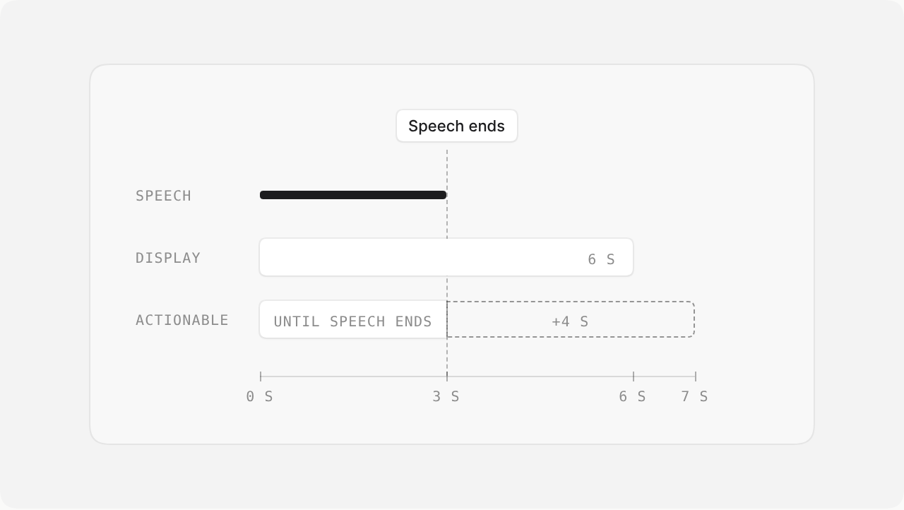](references/ai-life-light.png) |
| 单多垂域 (`domain`) | `parallel-containers` | [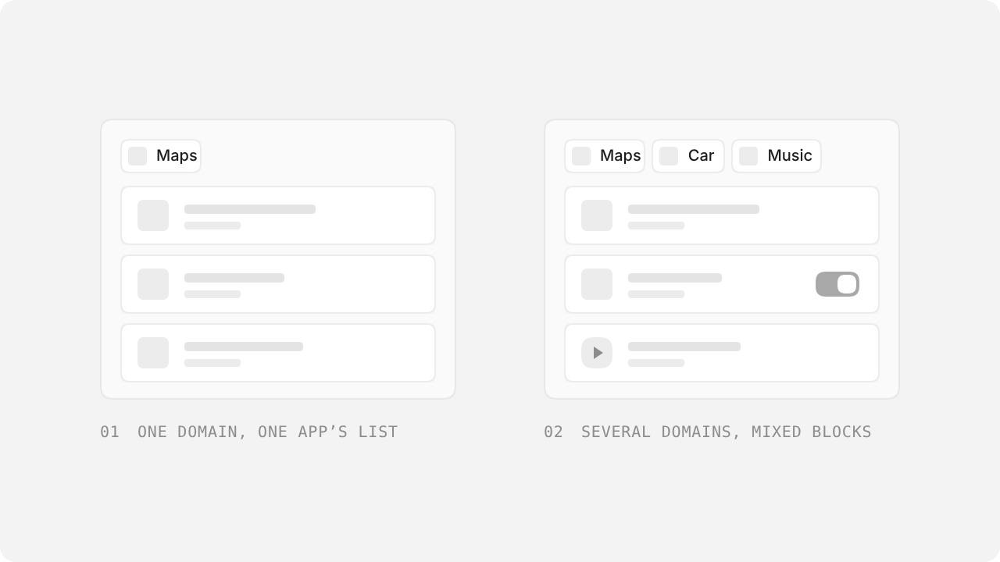](references/ai-domain-light.png) |
| 原子卡 (`anatomy`) | `structure-and-labels` | [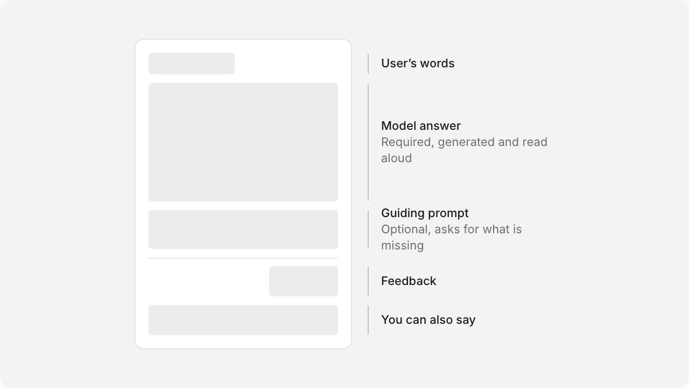](references/ai-anatomy-light.png) |
| 只有内容会变 (`grow`) | `frame-and-content` | [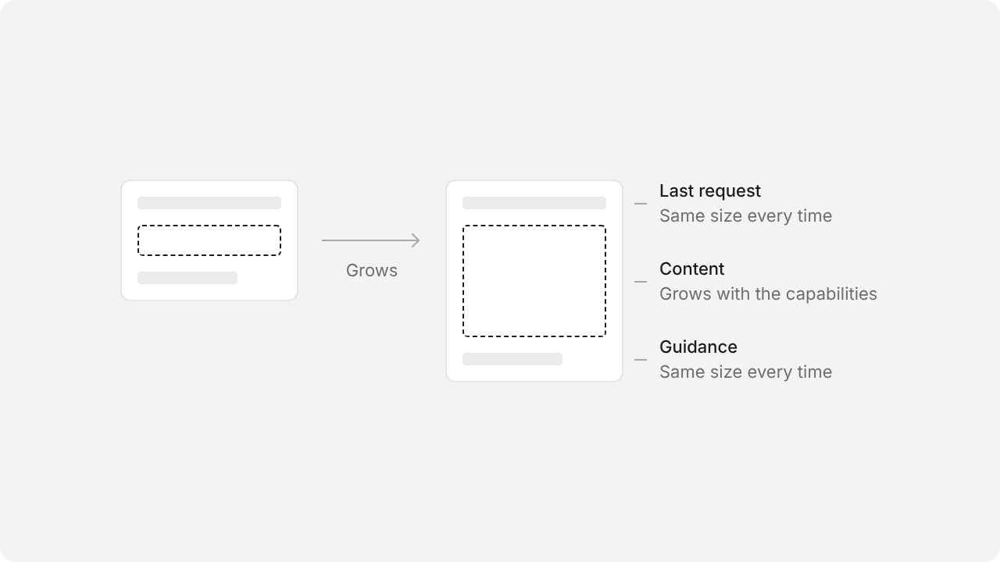](references/ai-grow-light.png) |
| 按格子计算 (`cells`) | `grid-allocation` | [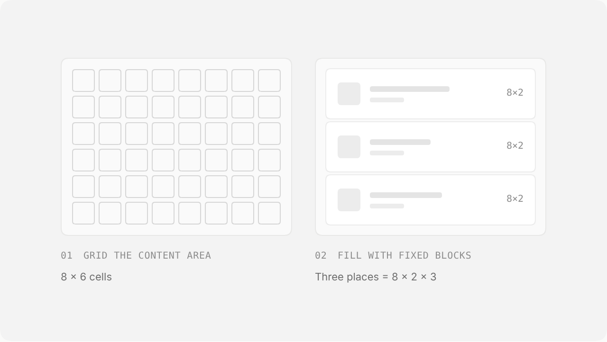](references/ai-cells-light.png) |
| D 挡镜头 (`drive`) | `camera-and-scene` | [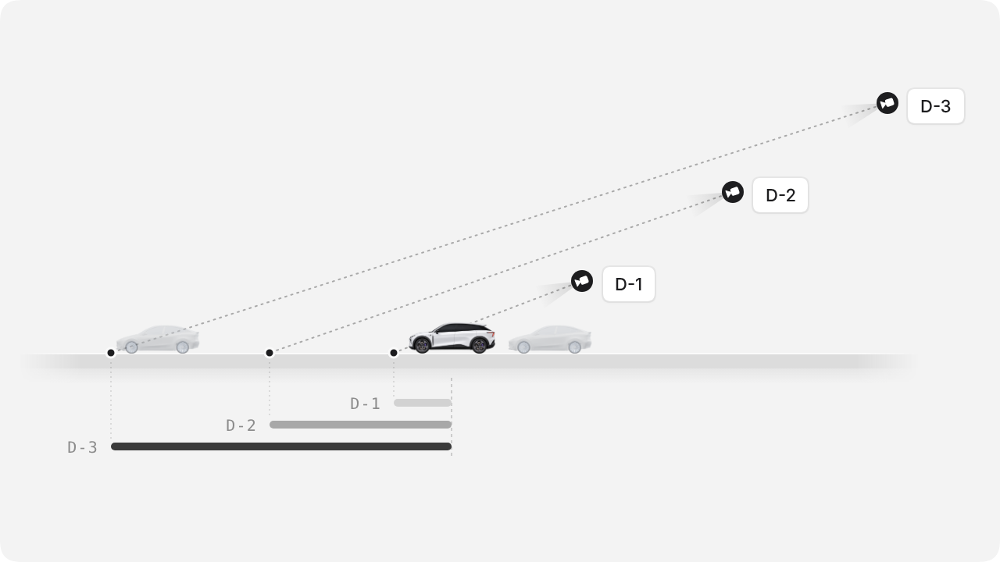](references/adas-drive-light.png) |
| R 挡泊车镜头 (`reverse`) | `camera-and-scene` | [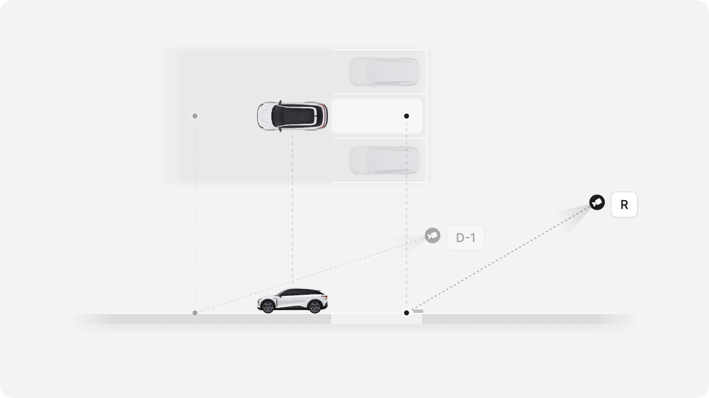](references/adas-reverse-light.png) |
